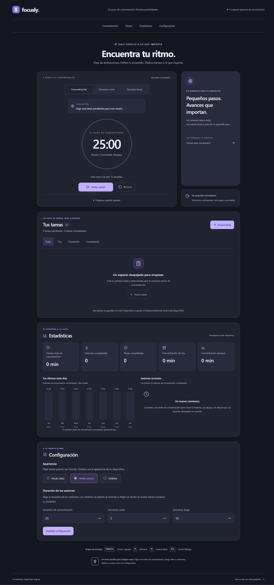

# Focusly

**Concéntrate. Organízate. Avanza.** A local-first productivity app built with React and TypeScript, with a Peruvian Spanish interface.

**Live:** [focusly.novatec.ink](https://focusly.novatec.ink/) · **Author:** Luis Armando Carranza Cortez

Focusly combines a Pomodoro timer, actionable tasks, daily goals and real focus statistics without requiring an account or a backend.



## Features

- **Recoverable Pomodoro:** absolute deadlines, pause/resume/reset, recovery after reload and shared timer state across tabs.
- **Coordinated local data:** Web Locks serialize updates and storage events synchronize cooperating tabs; session IDs prevent duplicate completion records.
- **Configurable rhythm:** 1–120 minute durations, 1–12 focuses before a long break, optional automatic breaks. Starting a new focus remains explicit.
- **Tasks:** priorities, dates, tags, subtasks, search, tag filters, date/priority sorting, one active task and safe undo of the latest task change.
- **Backups:** downloadable JSON and validated imports that merge new IDs without replacing existing tasks/history. Restoring preferences is optional and confirmed.
- **Focus mode:** timer and current task only, plus optional fullscreen.
- **Opt-in completion notices:** visual feedback, sound after user interaction and browser notifications after explicit permission. Cross-tab notice deduplication.
- **Productivity:** daily goal, seven-day chart, adjacent-week comparison, time grouped by task and historical title snapshots.
- **Appearance:** light, dark and system themes, responsive layout, official transparent logo and favicon.
- **Installable PWA:** manifest, PNG icons and a production Service Worker for offline reload after an initial successful visit.
- **Keyboard/accessibility:** visible focus, skip link, native dialogs with focus restoration, reduced motion and an option to disable Space/R/N shortcuts. Global shortcuts do not run inside forms or dialogs.

## Stack

React 19 · TypeScript 5.9 strict · Vite 8 · Tailwind CSS 4 · Lucide React · Vitest · ESLint · Playwright with Brave · axe-core

Playwright and axe-core are development-only dependencies used for meaningful browser and accessibility regression tests. They are not included in the app bundle.

## Getting started

Use Node.js 24 and npm:

```sh
npm ci
npm run dev
```

No environment variables, API keys or external services are needed to use the app. Development and production are different origins and keep separate browser data.

## Verification commands

| Command | Purpose |
| --- | --- |
| `npm run dev` | Development server |
| `npm run lint` | ESLint |
| `npm run typecheck` | Strict TypeScript checks |
| `npm test` | 52 unit tests |
| `npm run test:e2e` | Brave browser regression tests, including axe accessibility checks |
| `npm run build` | Types and production build |
| `npm run preview` | Local production preview |
| `npm audit` | Installed dependency audit |

Browser tests launch the installed Brave executable. On Windows the default is `C:/Program Files/BraveSoftware/Brave-Browser/Application/brave.exe`; on Linux it is `/usr/bin/brave-browser`. Override with `BRAVE_EXECUTABLE` if necessary. Each test uses an isolated browser context and does not access the user's normal profile.

## Project structure

```text
src/
  components/             Timer presentation
  features/
    tasks/                Model, organization, undo, forms and dialogs
    productivity/         History, settings and primary statistics
    preferences/          Themes and protected keyboard shortcuts
    enhancements/         Recovery, backups, cycles, goals, PWA and focus mode
  hooks/                  Shared timer lifecycle
  storage/                Validation and cross-tab transactions
  i18n/                   es-PE messages, dates and numbers
  utils/                  Pure timer transitions
e2e/                      Brave regression/accessibility tests
docs/                     Architecture, validation and release notes
.github/workflows/        Quality checks and gated production deployment
```

## Data and architecture

LocalStorage retains the backward-compatible `focusly:v1:data` envelope. Optional task metadata adds tags and subtasks without changing existing task IDs. Theme, options and the recoverable timer use separate versioned keys. Web Locks protect cooperating-tab read/modify/write transactions. Completion records are idempotent by session ID; time spent paused never contributes to focus totals.

Corrupt productivity data is preserved and the interface falls back to memory. Quota failures display a warning. Exports include user data: store them privately. Imports merge by ID; conflicting records keep their existing values. A backup is not an account or cloud synchronization service.

See [architecture](docs/ARCHITECTURE.md), [validation](docs/VALIDATION.md) and [enhancement release notes](docs/ENHANCEMENTS.md).

## Continuous delivery

On `main` and pull requests, CI installs dependencies, runs lint, types and unit tests, installs Brave from the official repository, runs browser/accessibility tests, builds and audits dependencies. Production deployment runs only after the quality job succeeds, on `main`, when repository variable `VERCEL_DEPLOY_ENABLED` is `true` and the encrypted `VERCEL_TOKEN` secret is configured. Pull requests cannot run the deployment job. The job uploads the exact validated static artifact to the existing Focusly project.

No Vercel credentials are stored in the repository. A project-scoped deployment token must be renewed before its expiration. Remote CI/deployment results are recorded only after an actual run has been inspected.

## Known limits

- No account, backend or cross-device synchronization. Clearing browser data removes local records; export backups first.
- Cross-tab locking relies on Web Locks in a secure origin, available in current Brave. Older unsupported browsers have best-effort coordination only. Old app versions must be refreshed to use the new synchronization protocol.
- The system clock remains the reference. Manual clock changes can affect active sessions.
- Sound requires user interaction and may be blocked after reload; the visual completion state remains available. Notifications require permission and an open app; suspended tabs notify on reactivation, not while the browser is closed.
- PWA installation depends on browser support. Offline reload requires the first shell cache to finish. Closing all old app tabs allows a waiting Service Worker update to activate.
- Undo applies to the latest task mutation in the current tab; it will not overwrite a subsequent change made in another tab. Import does not overwrite existing IDs or interrupt the running timer.
- Automated WCAG and keyboard checks are not certification. Manual testing with a screen reader has not yet been performed.
- No project license was selected without the author's decision. Dependencies retain their own licenses.

## Español

Focusly permite organizar tareas, recuperar sesiones, respaldar información y consultar avances en español de Perú. Los datos permanecen en el navegador y los avisos son opcionales.
